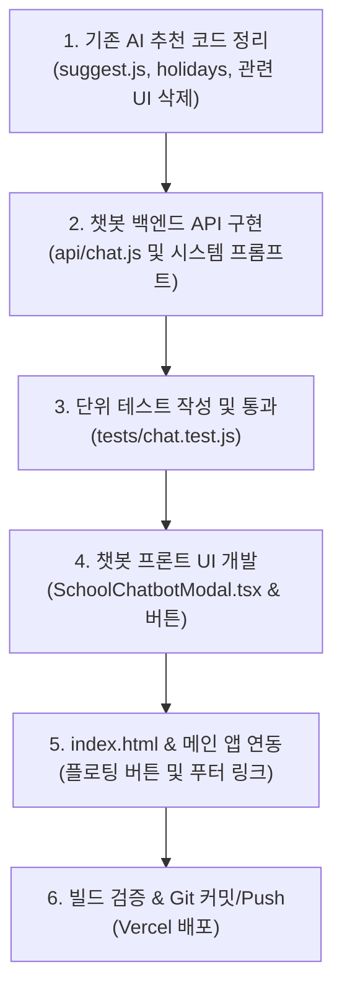

# 💬 플래닛 독서학교 챗봇 상담 기능 전환 및 AI 추천 제거 개발 계획서
**Document**: `CHATBOT_PLAN.md`  
**Date**: 2026-11-18  
**Project**: 2026 플래닛 독서학교 연말모임 「플래닛의 새학기 & 수학여행」

---

## 1. 개요 및 목적

- **목적**:
  1. 기존에 임시로 구현되었던 **'이 달의 공휴일 및 할 일 추천' AI 기능(`api/suggest.js`, 관련 컴포넌트 및 테스트)을 깔끔하게 제거(Rollback/Cleanup)**합니다.
  2. 연말모임 웹사이트 방문자 및 참가자가 행사 내용(일정, 장소, 드레스코드, 준비물, 학생증 발급, 정산 등)을 언제든 실시간으로 문의할 수 있는 **'챗봇 상담' 플로팅 버튼 및 대화창 시스템**을 새롭게 구축합니다.
- **기대 효과**:
  - 실제 사용자(플래닛 학우)에게 연말모임 행사 정보를 대화형으로 친절하게 제공하여 실용성과 UX를 대폭 향상.
  - 레트로 독서학교 컨셉(교무실 상담실 / 학생회 도우미)에 부합하는 일관된 브랜드 경험 완성.

---

## 2. 기존 AI 추천 기능 제거 (Cleanup 대상)

다음 파일 및 코드 영역을 완전히 정리하여 프로젝트를 깔끔한 상태로 복원합니다:

| 대상 파일 | 작업 내용 |
| :--- | :--- |
| `api/suggest.js` | 파일 삭제 (기존 월별 추천 엔드포인트) |
| `lib/holidays.js` | 파일 삭제 (공휴일 조회 모듈) |
| `src/utils/holidays.ts` | 파일 삭제 (프론트엔드 공휴일 모듈) |
| `src/components/AiSuggestSection.tsx` | 파일 삭제 (기존 추천 UI 컴포넌트) |
| `tests/suggest.test.js` | 파일 삭제 (기존 테스트) |
| `src/components/OfficialInvitation.tsx` | 푸터의 `✨ 오픈하사 AI 이 달의 추천` 링크 제거 |
| `src/components/PencilSketchRsvp.tsx` | `<AiSuggestSection />` 컴포넌트 임포트 및 렌더링 제거 |
| `index.html` | `<section id="ai-suggest-section">` 마크업 제거 및 클린업 |

---

## 3. 새로운 '챗봇 상담' 기능 설계

### 3.1 챗봇 버튼 (Entry Point)
- **플로팅 상담 버튼 (Floating Action Button)**:
  - 화면 우측 하단(또는 좌측 하단)에 항상 고정되어 언제든 원클릭으로 상담창을 열 수 있는 버튼.
  - 아이콘: `MessageSquareQuote` 또는 `GraduationCap` + `💬 챗봇 상담`
  - 배지 애니메이션: 가벼운 펄스(Pulse) 효과로 주목도 부여.
- **푸터 및 퀵 링크 버튼**:
  - 가정통신문 푸터 빠른 바로가기 영역에 `💬 교무실 챗봇 상담` 버튼 추가.

### 3.2 챗봇 상담창 모달 / 드로어 UI (`SchoolChatbotModal.tsx`)
- **디자인 테마**: 
  - 플래닛 독서학교 무드 (칠판 딥그린 `#16231b`, 모조지 크림 `#fcfbf9`, 브라운 우드 `#3d271d`)
  - 상단 헤더: `🏫 플래닛 독서학교 교무실 상담 도우미` (닫기 버튼 `✕`)
- **주요 기능 구성**:
  1. **원클릭 빠른 FAQ 버튼 (추천 질문)**:
     - 📅 `1부 & 2부 행사 일정과 장소가 어디인가요?`
     - 👔 `드레스코드(용의복장)는 어떻게 입어야 하나요?`
     - 📚 `선물할 책(1권)은 어떤 기준으로 준비하나요?`
     - 🪪 `학생증 발급 및 참가 신청 확인 방법`
     - 🧾 `학생회비 투명 정산 보고서는 어디서 보나요?`
  2. **실시간 질의응답 (Free Chat)**:
     - 사용자가 자유롭게 질문 입력 가능 (예: "취소 환불 규정이 어떻게 되나요?", "주차 가능한가요?")
     - 말풍선 UI: 사용자(우측 버건디 톤), 챗봇(좌측 크림/그린 톤)
  3. **4대 화면 상태 (UI States)**:
     - **대기/안내 상태**: 환영 인사 및 빠른 질문 버튼 목록
     - **답변 생성 중 (Loading)**: 타이핑 애니메이션 (`... 플래닛 상담원이 답변을 작성 중입니다`)
     - **정상 답변 (Success)**: 마크다운/줄바꿈이 적용된 깔끔한 답변 말풍선
     - **오류 안내 (Error)**: 네트워크 지연 또는 한도 초과 시 안내 문구 + "다시 시도" 버튼 및 운영진 오픈채팅/연락망 안내

---

## 4. 백엔드 상담 API 설계 (`api/chat.js`)

- **엔드포인트**: `POST /api/chat`
- **인증 및 키**: 기존 등록된 `process.env.HASA_API_KEY` 그대로 재활용 (Open HASA `gemma-4-31b`)
- **시스템 프롬프트 (System Knowledge Base)**:
  - `PROJECT_PLAN.md`에 명시된 2026 연말모임 공식 정보를 시스템 프롬프트에 주입:
    - **1부 「플래닛의 새학기」**: 2026-12-26(토) 10:00~17:00 @ 공간나인 강남점 (정원 35명, 회비 45,000원)
    - **2부 「플래닛의 수학여행」**: 18:00~LATE @ 강남 프라이빗 파티룸 (정원 25명, 실비 정산)
    - **드레스코드**: 단정한 스쿨룩 & 클래식 프레피 (블레이저, 셔츠, 케이블니트, 뿔테안경)
    - **준비물**: 소장용/선물용 책 1권 이상 + 정성스러운 추천 편지
    - **특징**: 투명 정산 보고서 제공, 짝꿍 교실 자리배치 알고리즘, 모바일 학생증 발급
  - 다정하고 친절한 "독서학교 조교/선생님" 말투로 3~5줄 내외의 명확한 답변 생성.
- **오류 처리 및 안정성**:
  - `AbortSignal.timeout(20000)` (20초 타임아웃 보장)
  - 빈 질문 또는 비정상 요청: 400
  - API 키 미설정: 500 (키 정보 비노출)
  - 한도 초과(429) 및 시간 초과: 사용자 친화적 안내 문구 반환

---

## 5. 단위 테스트 계획 (`tests/chat.test.js`)

`node --test` 환경에서 외부 API 의존 없이 Mock 기반으로 검증:
1. **정상 질의응답 (200)**: 질문 전달 시 행사 관련 답변 말풍선 반환
2. **입력 누락 (400)**: 빈 문자열 또는 형식 오류 시 400 반환
3. **키 부재 (500)**: `HASA_API_KEY` 없을 시 500 에러 및 키 미노출
4. **한도 초과 (429)**: 일시적 한도 초과 시 친절 안내 메시지 반환
5. **시간 초과 (20초)**: 타임아웃 발생 시 안내 메시지 반환

기존 `guestbook.test.js`와 함께 `npm test`로 일괄 검증.

---

## 6. 단계별 작업 순서

---

## 7. 확인 및 결정 사항

1. **상담 챗봇 말투/페르소나**:
   - `플래닛 독서학교 학생회 친절한 조교` (기본 추천: 예의 바르고 다정한 학교 선배 톤)
2. **플로팅 버튼 위치**:
   - 화면 우측 하단 고정 (현재 존재하는 관리자/전환 스위처와 겹치지 않도록 z-index 및 위치 최적화)
3. **기존 등록된 Vercel `HASA_API_KEY` 재활용 여부**:
   - 이미 Vercel에 등록해 두신 `HASA_API_KEY`를 그대로 활용하여 추가 키 발급이나 등록 절차 없이 바로 작동 가능합니다.
